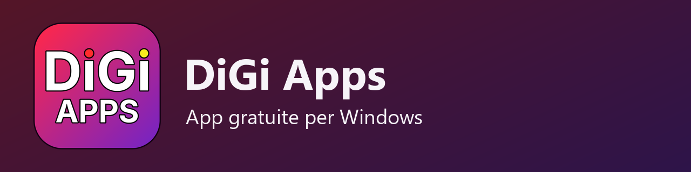
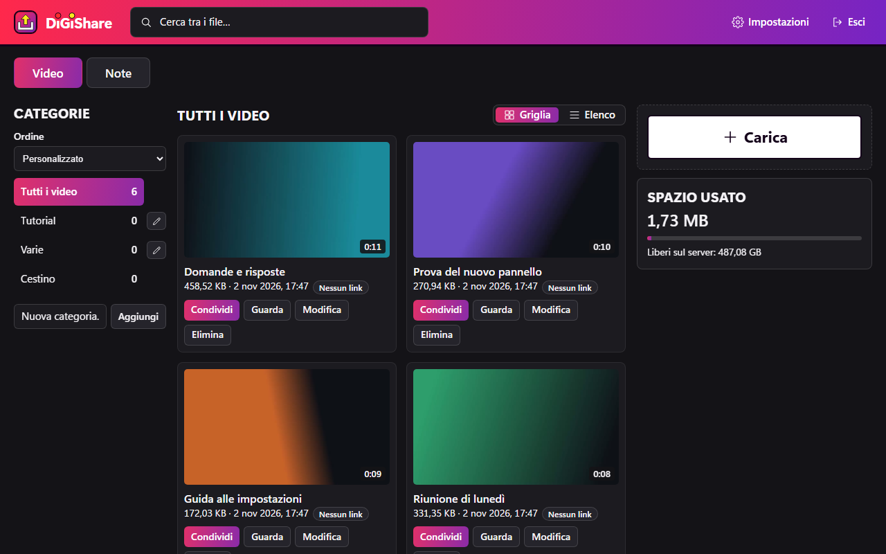
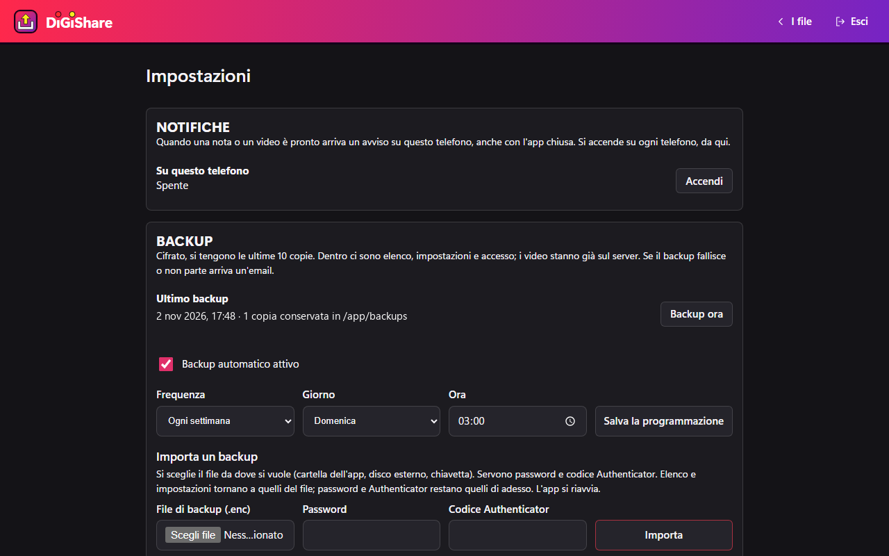
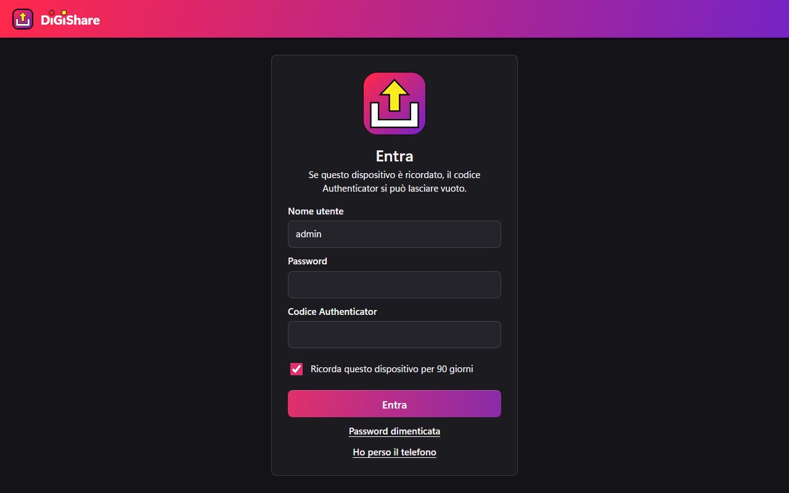

<p align="center">
  
</p>

<p align="center">
  
</p>

# DiGiShare

## 📤 Il tuo server per condividere video e file e per trascrivere le note di DiGiNotes

### ⬇️ [Installa DiGiShare con Docker](#installazione-con-docker)

Gira con Docker sul tuo NAS o sul tuo PC: i file restano da te. DiGiShare fa parte di **DiGi Apps**, app gratuite.

### Cosa fa

- **Video e file:** carichi anche file grandi, il caricamento riprende se la rete cade, e li metti in categorie.
- **Link di condivisione:** per chiunque o solo per le email che scegli, con scadenza e permesso di scaricare.
- **Sottotitoli, capitoli e descrizione** dei video con l'IA, se metti le chiavi.
- **Note di [DiGiNotes](https://github.com/DiGi-Apps-Dev/DiGiNotes):** l'audio arriva dal telefono e torna con trascrizione, chi parla e riassunto ordinato.
- **Esporta le note** in Word, PDF, Markdown e testo.
- **Notifiche sul telefono** quando una nota o un video è pronto.
- **Accesso protetto** con password e Authenticator, e backup cifrati dell'elenco e delle impostazioni.
- **Facoltativi:** filtro del rumore, riconoscimento della tua voce, importazione delle registrazioni Zoom.

## Come si vede

<p align="center">
  
</p>

| | |
|---|---|
|  |  |

## Installazione con Docker

Serve un NAS o un PC con Docker e Docker Compose, su processore x86-64.

**1. Scarica il codice e prepara le cartelle.**

```bash
git clone https://github.com/DiGi-Apps-Dev/DiGiShare.git
cd DiGiShare
mkdir -p dati backups
sudo chown -R 1000:100 dati backups
cp .env.example .env
```

**2. Metti la chiave nel `.env`.** Genera la chiave con questo comando e incollala dopo `DIGISHARE_AUTH_KEY=`.

```bash
openssl rand -base64 32 | tr '+/' '-_' | tr -d '='
```

Nello stesso file metti le chiavi di Gemini e Groq, se vuoi trascrizione e riassunto: si creano su [Google AI Studio](https://aistudio.google.com/apikey) e [Groq](https://console.groq.com/keys). Controlla sui loro siti limiti e condizioni dei piani gratuiti. L'audio delle note e dei video esce verso questi servizi per essere trascritto; senza chiavi non esce niente e DiGiShare resta un archivio con i link.

**3. Avvia.** La prima volta la costruzione può durare parecchi minuti e serve almeno 1 GB di memoria libera.

```bash
docker compose up -d --build
```

## Il primo utente

Esiste un solo utente, e lo crei tu.

1. Installa sul telefono un'app Authenticator (Google Authenticator, Aegis o simili).
2. Apri `http://<indirizzo-del-server>:8795/accesso` dalla tua rete di casa.
3. Scegli nome utente e password, inquadra il codice QR con l'Authenticator e scrivi il codice di 6 cifre.
4. Chiudi la creazione di nuovi utenti: nel `.env` metti `DIGISHARE_ALLOW_SETUP=0`, poi ricrea il container.

```bash
docker compose up -d --force-recreate
```

Conserva `DIGISHARE_AUTH_KEY` e i codici dell'Authenticator: se li perdi non rientri.

## Raggiungerlo da fuori e collegare DiGiNotes

Non aprire la porta 8795 su internet. Per l'uso fuori casa, per DiGiNotes e per le notifiche sul telefono serve HTTPS, con un proxy che hai già o che installi (Nginx Proxy Manager, Caddy o simili).

- Il proxy inoltra a `digishare:8795`, e deve stare nella stessa rete Docker: aggiungi la rete in `compose.yml`.
- Scrivi il nome del proxy nella rete Docker in `PROXY_FIDATO` e il tuo indirizzo in `INDIRIZZO_PUBBLICO`, poi ricrea il container.
- Nel proxy imposta 60 MB come grandezza massima della richiesta e spegni il buffering delle richieste: i caricamenti viaggiano a pezzi da 50 MB.

In DiGiNotes apri **Impostazioni › Cloud › DiGiShare** e scrivi il tuo indirizzo `https://`, nome utente, password e codice.

## Filtro del rumore e riconoscimento della voce

Sono spenti, e si accendono a parte: istruzioni in [bin/LEGGIMI.txt](bin/LEGGIMI.txt) e [voci/LEGGIMI.txt](voci/LEGGIMI.txt).

## Aggiornare

```bash
git pull
docker compose up -d --build
```

## Prove sul codice

Serve Node 24 e `ffmpeg`.

```bash
npm ci
npm test
```

## Disinstallare

```bash
docker compose down
```

Le cartelle `dati` e `backups` restano: cancellale tu solo se non ti servono più, perché dentro ci sono i tuoi file.

## Licenza

DiGiShare è gratuito, con licenza **MIT** (vedi [LICENSE](LICENSE)). Usa componenti di terze parti con le loro licenze, elencati in `package.json`, oltre a FFmpeg e, se li attivi, DeepFilterNet e sherpa-onnx.
